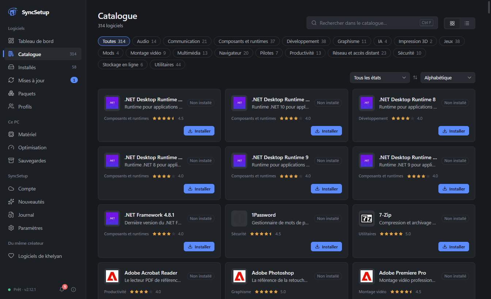
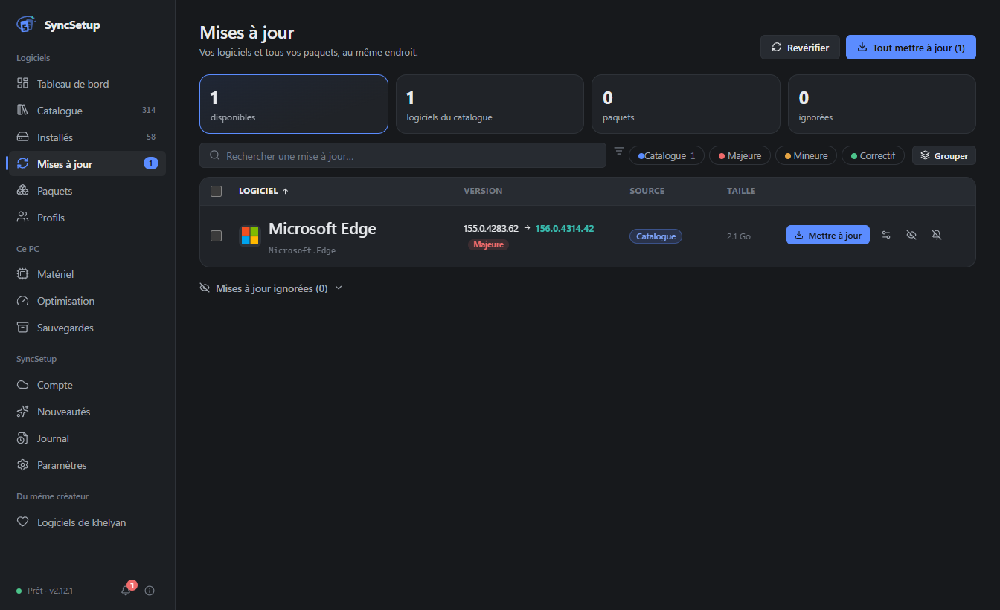
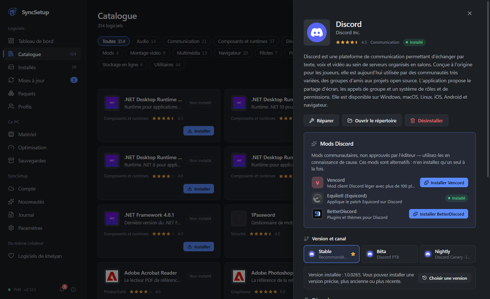
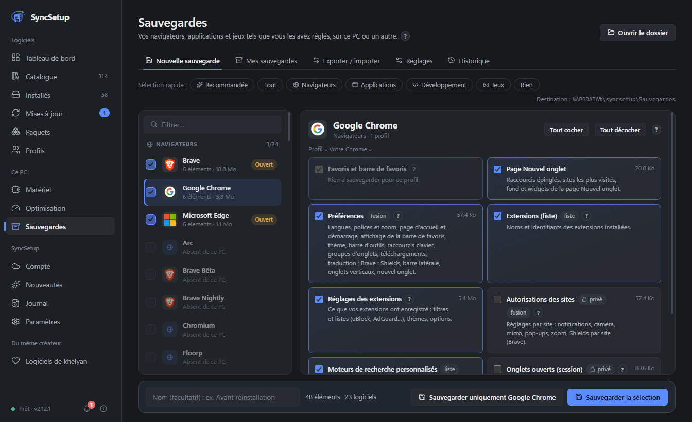
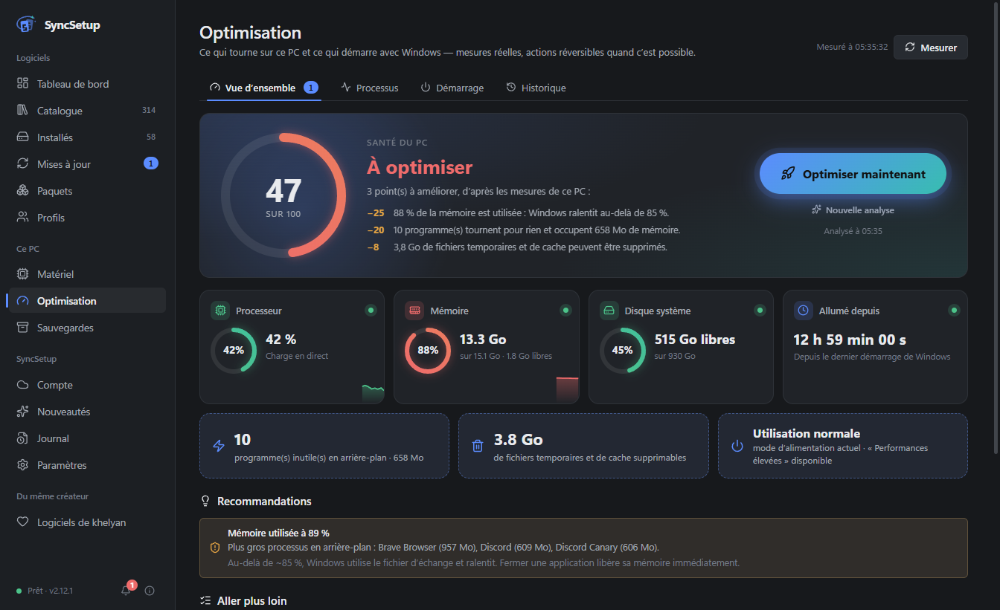
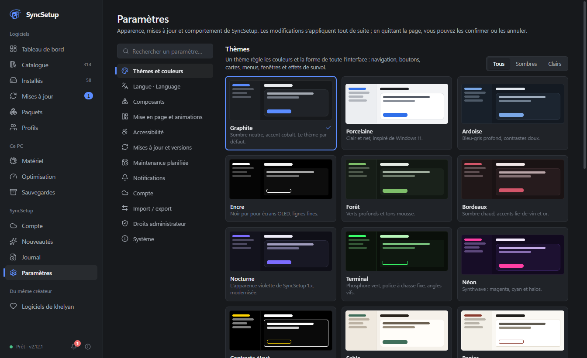

<div align="center">


# SyncSetup

### Tous vos logiciels Windows, au même endroit.

Installez, mettez à jour, réparez et désinstallez vos logiciels — sauvegardez vos navigateurs, applications et jeux — et retrouvez toute votre configuration sur un nouveau PC en quelques clics.

[](https://github.com/khelyan2k/SyncSetup-releases/releases/latest) [](https://github.com/khelyan2k/SyncSetup-releases/releases)  

**[⬇️ Télécharger](https://github.com/khelyan2k/SyncSetup-releases/releases/latest)** · **[Nouveautés](https://github.com/khelyan2k/SyncSetup-releases/releases)** · **[Signaler un bug](https://github.com/khelyan2k/SyncSetup-releases/issues)** · **[🇬🇧 English version](README.md)**

<br />


</div>

<br />

## Pourquoi SyncSetup ?

Préparer un PC, c'est visiter des dizaines de sites, cliquer dans des installateurs, puis tout tenir à jour à la main. **SyncSetup le fait pour vous** — et le fait avec soin :

- 🧩 **Une seule application pour tout** — 478 logiciels choisis, plus tous les paquets de winget, Scoop, Chocolatey, pip, npm et 6 autres gestionnaires.
- 🔒 **Uniquement des sources officielles** — les logiciels viennent de leur éditeur, via winget (le gestionnaire de paquets de Microsoft) ou le Microsoft Store. Jamais d'installateur reconditionné.
- ✅ **Rien n'est supposé** — chaque installation, mise à jour ou désinstallation est vérifiée après coup. Si ça n'a pas marché, SyncSetup vous dit pourquoi, simplement.
- 💾 **Votre configuration, partout** — profils, sauvegardes et export complet pour passer à un nouveau PC sans repartir de zéro.

<br />

## ✨ Fonctionnalités

<table>
<tr>
<td width="50%" valign="top">

### 📦 Catalogue

**478 logiciels** en 40 catégories et 7 groupes — navigateurs, jeux, messagerie, développement, vidéo, sécurité, pilotes, streaming, VPN… Un logiciel peut être dans plusieurs catégories (OBS : streaming et montage vidéo).

- Installation en un clic depuis la **source officielle**, ou la version du **Microsoft Store** si vous préférez
- Choix d'une **version précise** ou d'un canal (stable, bêta, nightly, LTS…)
- **Mods** en un clic : Spicetify pour Spotify, Vencord, Equicord, BetterDiscord
- Services web sans application Windows (YouTube…) en raccourcis web clairement indiqués
- Filtre **Alternatives** : des équivalents gratuits ou libres aux logiciels payants, avec le prix relevé et sa source
- Bouton **Lancer** sur les logiciels installés

</td>
<td width="50%" valign="top">



</td>
</tr>
<tr>
<td width="50%" valign="top">



</td>
<td width="50%" valign="top">

### 🔄 Mises à jour

Tous vos logiciels **et** vos paquets dans une seule liste.

- Tout mettre à jour en un clic — **plusieurs à la fois** quand c'est sans risque (jamais deux installations Windows Installer ensemble)
- Vitesse de téléchargement en direct, statuts clairs : ✅ terminé · ℹ️ déjà à jour · ⚠️ à revoir · ❌ échec, avec la raison
- Rappels quand des mises à jour attendent (au démarrage, toutes les 2, 4 ou 8 h)
- **Maintenance planifiée** : vérification et mise à jour automatiques selon votre planning, pour tous les logiciels, tous sauf certains ou seulement certains ; changements de version majeure soumis à votre accord
- Ignorer une version, un logiciel pour de bon, ou **reporter de 7 jours** ; **revenir à la version d'avant** quand l'éditeur la publie encore
- Logiciel dont l'installateur a changé de type (Edge…) : outil de mise à jour de l'éditeur, sinon migration proposée, jamais sans votre accord

</td>
</tr>
<tr>
<td width="50%" valign="top">

### 🖥️ Logiciels installés

- Tout ce qui est installé sur le PC — même les **logiciels portables** déposés sur le Bureau et les jeux installés par **Steam, Epic, Riot**…
- Onglet **Autres programmes** : désinstallez tout ce que Windows connaît, avec son désinstalleur officiel
- Les installations faites en dehors de SyncSetup sont vues automatiquement
- Une mise à jour bloquée ? SyncSetup trouve le programme qui retient les fichiers et propose **Fermer et réessayer**
- Désinstaller **plusieurs logiciels à la fois**, avec un récapitulatif avant de confirmer ; chaque désinstallation est vérifiée, sans faux « échec » quand Windows tarde à se mettre à jour
- **Historique** de chaque opération : version avant / après, durée, code, explication en clair et quoi faire

</td>
<td width="50%" valign="top">



</td>
</tr>
<tr>
<td width="50%" valign="top">



</td>
<td width="50%" valign="top">

### 💾 Sauvegardes et transfert

**76 navigateurs, applications et jeux** : favoris, réglages, extensions, Discord et ses mods, Spotify, VS Code, mondes Minecraft, collections Steam, réglages de VALORANT…

- Restauration sur ce PC ou un autre, **intégrité vérifiée** (SHA-256)
- **Jamais** de mot de passe, de cookie ni de session de connexion
- **Exporter / importer** tout SyncSetup dans un seul fichier
- **Profils** : votre liste de logiciels, réinstallée en un clic sur un nouveau PC
- Sauvegarde facultative dans un **Gist GitHub secret**
- **Migration vers un nouveau PC** : aperçu de ce qui sera installé, reprise après une coupure, rapport final
- Import d'une liste **`winget export`** ou d'un bundle **UniGetUI**

</td>
</tr>
<tr>
<td width="50%" valign="top">

### ⚡ Optimisation

- **Optimiser maintenant** : ferme ce qui tourne pour rien, libère la mémoire, nettoie les fichiers temporaires — avec un score de santé basé sur de vraies mesures
- Connaît des centaines de programmes : ce qui peut être fermé, ce qui doit rester ouvert (pilotes, antivirus, anti-triche, synchronisation…)
- **Gestion du démarrage**, y compris les éléments de tous les utilisateurs, avec un avertissement avant de désactiver quelque chose d'important
- Matériel et pilotes en un coup d'œil, périphériques nommés par leur vrai nom
- **Bluetooth sur le tableau de bord** : appareils connectés, appairés et à proximité ; connecter ou déconnecter enceintes et casques en un clic
- **Batterie des appareils Bluetooth** qui la transmettent à Windows, avec alerte de batterie faible et **bulles de batterie** flottantes facultatives, qui ne prennent jamais le focus

</td>
<td width="50%" valign="top">



</td>
</tr>
<tr>
<td width="50%" valign="top">



</td>
<td width="50%" valign="top">

### 🎨 Fait pour vous

- **16 thèmes** (sombres, clairs, OLED, contraste élevé…), couleurs, densité, animations — ou créez le vôtre
- **Profil de performances** : plus léger sur un PC modeste, plus riche sur un PC récent
- **Français ou anglais**
- Raccourcis clavier, recherche partout, centre de notifications, zone de notification
- **Se met à jour tout seul** (téléchargement vérifié, retour à n'importe quelle version précédente en un clic)
- **Tutoriel** guidé à la première ouverture (facultatif)
- Fenêtre **Quoi de neuf** après chaque mise à jour, une seule fois
- **Assistant** 100 % local : décrivez votre besoin ou nommez un logiciel (fautes tolérées) ; aide intégrée et bulle flottante
- **Ligne de commande** pour les utilisateurs avancés (`syncsetup.cmd`)

</td>
</tr>
</table>

<br />

## 🔒 Sûr par conception

| | |
|---|---|
| **Sources officielles uniquement** | Les logiciels s'installent via winget ou le Microsoft Store, avec les fichiers de leur éditeur. Quand SyncSetup doit télécharger lui-même l'installateur d'un éditeur, sa **signature numérique** est vérifiée avant de le lancer. |
| **Vérifié, jamais supposé** | Une opération n'est annoncée réussie qu'après vérification du résultat sur votre PC. |
| **Vos données restent chez vous** | Paramètres et sauvegardes restent sur votre PC (`%APPDATA%\syncsetup`). **Aucun compte obligatoire, aucune publicité, aucune télémétrie.** Sauvegarde en ligne (Gist GitHub secret) seulement si vous l'activez. L'assistant et la batterie fonctionnent entièrement sur votre PC. |
| **Aucun secret copié** | Les sauvegardes ne contiennent jamais de mot de passe, de cookie, de données de paiement ni de jeton de connexion. |
| **Sécurité de Windows respectée** | Le mode administrateur est facultatif et ne contourne jamais l'invite UAC de Windows. Les éléments de démarrage importants et les pilotes sont protégés par une confirmation. |
| **Mises à jour vérifiées** | Chaque mise à jour de SyncSetup est contrôlée (SHA-512) avant d'être installée, et vous pouvez revenir en arrière à tout moment. |
| **Téléchargements vérifiables** | Chaque version publie les empreintes SHA256 de ses fichiers (`SHA256SUMS.txt`) : voir [Vérifier un téléchargement](#-vérifier-un-téléchargement). |

<br />

## 📥 Installation

1. Téléchargez **`SyncSetup-Setup-x.y.z.exe`** depuis la **[dernière version](https://github.com/khelyan2k/SyncSetup-releases/releases/latest)**.
2. Lancez-le : choisissez la langue, puis les options de fin (lancer SyncSetup, démarrage avec Windows, raccourcis) — il s'installe pour votre compte Windows, sans droits administrateur. Déjà installé ? Il propose de mettre à niveau, réparer ou désinstaller.
3. C'est tout. SyncSetup se met ensuite à jour tout seul.

> [!NOTE]
> L'installateur n'est pas encore signé (un certificat coûte plusieurs centaines d'euros par an) : Windows peut afficher **« Windows a protégé votre ordinateur »**. Cliquez sur **Informations complémentaires → Exécuter quand même**. Vous pouvez vérifier chaque version sur [VirusTotal](https://www.virustotal.com) avant de la lancer.

**Configuration requise :** Windows 10 ou 11, 64 bits · winget (inclus dans Windows 11 et Windows 10 à jour).

<br />

## 🔐 Vérifier un téléchargement

Chaque version publie l'empreinte SHA256 de ses fichiers : dans le fichier **`SHA256SUMS.txt`** joint à la version et dans la section « Vérification d'intégrité » de ses notes. Si l'empreinte de votre fichier est identique, il n'a pas été modifié.

Dans PowerShell, depuis le dossier du téléchargement :

```powershell
Get-FileHash .\SyncSetup-Setup-x.y.z.exe -Algorithm SHA256
```

Ou dans l'invite de commandes :

```bat
certutil -hashfile SyncSetup-Setup-x.y.z.exe SHA256
```

Les mises à jour automatiques de SyncSetup font ce contrôle toutes seules (empreinte SHA-512 de `latest.yml`).

<br />

## ❓ Questions fréquentes

<details>
<summary><b>SyncSetup est-il gratuit ?</b></summary>
<br />
Oui, entièrement — sans publicité, sans version payante, sans compte obligatoire.
</details>

<details>
<summary><b>Quelle différence avec winget, UniGetUI ou Ninite ?</b></summary>
<br />
SyncSetup s'appuie sur winget, comme UniGetUI, et couvre toute la liste de Ninite. En plus, il vérifie chaque résultat, explique les erreurs simplement, sauvegarde et restaure les réglages de vos logiciels, transfère votre configuration vers un nouveau PC et vous aide à garder le PC propre et rapide.
</details>

<details>
<summary><b>Faut-il le lancer en administrateur ?</b></summary>
<br />
Non. Il fonctionne avec vos droits normaux ; Windows demande l'autorisation quand un installateur en a besoin. Un mode administrateur facultatif (une seule confirmation Windows, une fois) évite les demandes répétées. Les logiciels qui refusent l'administrateur sont automatiquement lancés avec vos droits normaux.
</details>

<details>
<summary><b>Où sont mes données et mes sauvegardes ?</b></summary>
<br />
Dans <code>%APPDATA%\syncsetup</code> sur votre PC (sauvegardes dans <code>%APPDATA%\syncsetup\Sauvegardes</code>, ou dans le dossier de votre choix — un dossier OneDrive est idéal pour les retrouver sur un autre PC).
</details>

<details>
<summary><b>À quoi SyncSetup se connecte-t-il ?</b></summary>
<br />
À winget et aux registres de paquets que vous utilisez (pour installer et mettre à jour), à GitHub (mises à jour de SyncSetup lui-même), à des services d'icônes (icônes des logiciels) — et, seulement si vous l'activez, à votre Gist GitHub pour la sauvegarde en ligne. Si vous avez connecté GitHub, cette même connexion sert aussi à savoir si vous avez mis une étoile au dépôt (aucune permission en plus). L'assistant de recommandation et la lecture de la batterie ne se connectent à rien. Rien d'autre.
</details>

<details>
<summary><b>Comment le désinstaller ?</b></summary>
<br />
Paramètres Windows › Applications › SyncSetup › Désinstaller (ou relancez l'installateur). Vous choisissez : <b>conserver vos données</b> (par défaut, pour une réinstallation) ou <b>tout supprimer</b> (<code>%APPDATA%\syncsetup</code> et les réglages de SyncSetup ; vos sauvegardes de logiciels peuvent être gardées). Vos logiciels installés ne sont jamais touchés.
</details>

<details>
<summary><b>Tout fonctionne-t-il pour tous les logiciels ?</b></summary>
<br />
Installer, mettre à jour et désinstaller : oui, pour tout le catalogue. D'autres fonctions dépendent du logiciel : <b>choix de version</b> et <b>retour arrière</b> (si winget publie encore la version), <b>réparation</b> (si son installateur la propose), <b>installation silencieuse</b> (si son installateur le permet), bouton <b>Lancer</b> (si SyncSetup trouve un point d'entrée sûr), <b>mods</b> (Spotify et Discord), <b>batterie</b> (seulement les appareils Bluetooth qui la transmettent à Windows). La fiche technique de chaque logiciel indique ce qui est possible.
</details>

<br />

## 💬 Aide

Un bug, une idée ? **[Ouvrez un ticket](https://github.com/khelyan2k/SyncSetup-releases/issues)** — ou écrivez-moi sur Discord : **`.khelyan`**.

Si SyncSetup vous fait gagner du temps, une ⭐ sur cette page aide beaucoup ! Et si vous voulez aller plus loin : **[☕ Soutenir SyncSetup sur Ko-fi](https://ko-fi.com/syncsetup)**.

Une faille de sécurité ? Ne la publiez pas : suivez [SECURITY.md](SECURITY.md) (signalement privé).

[Conditions d'utilisation](CONDITIONS_UTILISATION.md) · [Composants tiers](THIRD-PARTY-NOTICES.txt) · [Documentation (wiki)](https://github.com/khelyan2k/SyncSetup-releases/wiki)

<br />

<div align="center">

Fait avec ❤️ par **[khelyan](https://github.com/khelyan2k)**

</div>
