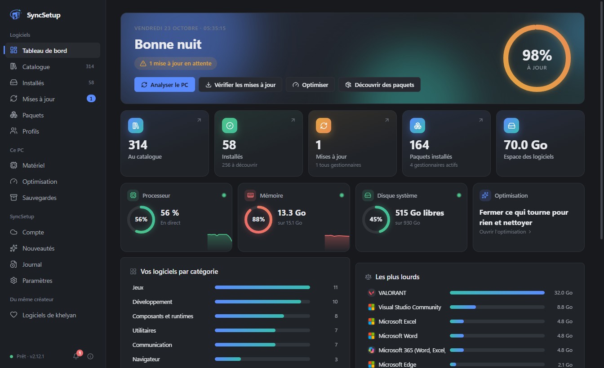

# SyncSetup

### Tous vos logiciels Windows, au même endroit.

Installez, mettez à jour, réparez et désinstallez vos logiciels — sauvegardez vos navigateurs, applications et jeux — et retrouvez toute votre configuration sur un nouveau PC en quelques clics.

   

**[⬇️ Télécharger](https://github.com/khelyan2k/SyncSetup-releases/releases/latest)** · **[Nouveautés](https://github.com/khelyan2k/SyncSetup-releases/releases)** · **[Signaler un bug](https://github.com/khelyan2k/SyncSetup-releases/issues)** · **[🇬🇧 English version](README.md)**

 

 

## Pourquoi SyncSetup ?

Préparer un PC, c'est visiter des dizaines de sites, cliquer dans des installateurs, puis tout tenir à jour à la main. **SyncSetup le fait pour vous** — et le fait avec soin :

- 🧩 **Une seule application pour tout** — 314 logiciels choisis, plus tous les paquets de winget, Scoop, Chocolatey, pip, npm et 6 autres gestionnaires.
- 🔒 **Uniquement des sources officielles** — les logiciels viennent de leur éditeur, via winget (le gestionnaire de paquets de Microsoft) ou le Microsoft Store. Jamais d'installateur reconditionné.
- ✅ **Rien n'est supposé** — chaque installation, mise à jour ou désinstallation est vérifiée après coup. Si ça n'a pas marché, SyncSetup vous dit pourquoi, simplement.
- 💾 **Votre configuration, partout** — profils, sauvegardes et export complet pour passer à un nouveau PC sans repartir de zéro.

 

## ✨ Fonctionnalités

<table>
<tr>
<td width="50%" valign="top">

### 📦 Catalogue

**314 logiciels** classés par catégorie — navigateurs, jeux, communication, développement, vidéo, sécurité, pilotes, streaming, VPN…

- Installation en un clic depuis la **source officielle**, ou la version du **Microsoft Store** si vous préférez
- Choix d'une **version précise** ou d'un canal (stable, bêta, nightly, LTS…)
- **Mods** en un clic : Spicetify pour Spotify, Vencord, Equicord, BetterDiscord
- Services web sans application Windows (YouTube…) en raccourcis web clairement indiqués

</td>
<td width="50%" valign="top">

</td>
</tr>
<tr>
<td width="50%" valign="top">

</td>
<td width="50%" valign="top">

### 🔄 Mises à jour

Tous vos logiciels **et** vos paquets dans une seule liste.

- Tout mettre à jour en un clic — **plusieurs à la fois** quand c'est sans risque (jamais deux installations Windows Installer ensemble)
- Vitesse de téléchargement en direct, statuts clairs : ✅ terminé · ℹ️ déjà à jour · ⚠️ à revoir · ❌ échec, avec la raison
- Rappels quand des mises à jour attendent (au démarrage, toutes les 2, 4 ou 8 h)
- **Maintenance planifiée** : vérification et mise à jour automatiques, selon votre planning
- Ignorer une version, ou un logiciel pour de bon

</td>
</tr>
<tr>
<td width="50%" valign="top">

### 🖥️ Logiciels installés

- Tout ce qui est installé sur le PC — même les **logiciels portables** déposés sur le Bureau et les jeux installés par **Steam, Epic, Riot**…
- Onglet **Autres programmes** : désinstallez tout ce que Windows connaît, avec son désinstalleur officiel
- Les installations faites en dehors de SyncSetup sont vues automatiquement
- Une mise à jour bloquée ? SyncSetup trouve le programme qui retient les fichiers et propose **Fermer et réessayer**

</td>
<td width="50%" valign="top">

</td>
</tr>
<tr>
<td width="50%" valign="top">

</td>
<td width="50%" valign="top">

### 💾 Sauvegardes et transfert

**76 navigateurs, applications et jeux** : favoris, réglages, extensions, Discord et ses mods, Spotify, VS Code, mondes Minecraft, collections Steam, réglages de VALORANT…

- Restauration sur ce PC ou un autre, **intégrité vérifiée** (SHA-256)
- **Jamais** de mot de passe, de cookie ni de session de connexion
- **Exporter / importer** tout SyncSetup dans un seul fichier
- **Profils** : votre liste de logiciels, réinstallée en un clic sur un nouveau PC
- Sauvegarde facultative dans un **Gist GitHub secret**

</td>
</tr>
<tr>
<td width="50%" valign="top">

### ⚡ Optimisation

- **Optimiser maintenant** : ferme ce qui tourne pour rien, libère la mémoire, nettoie les fichiers temporaires — avec un score de santé basé sur de vraies mesures
- Connaît des centaines de programmes : ce qui peut être fermé, ce qui doit rester ouvert (pilotes, antivirus, anti-triche, synchronisation…)
- **Gestion du démarrage**, y compris les éléments de tous les utilisateurs, avec un avertissement avant de désactiver quelque chose d'important
- Matériel et pilotes en un coup d'œil

</td>
<td width="50%" valign="top">

</td>
</tr>
<tr>
<td width="50%" valign="top">

</td>
<td width="50%" valign="top">

### 🎨 Fait pour vous

- **16 thèmes** (sombres, clairs, OLED, contraste élevé…), couleurs, densité, animations — ou créez le vôtre
- **Profil de performances** : plus léger sur un PC modeste, plus riche sur un PC récent
- **Français ou anglais**
- Raccourcis clavier, recherche partout, centre de notifications, zone de notification
- **Se met à jour tout seul** (téléchargement vérifié, retour à n'importe quelle version précédente en un clic)

</td>
</tr>
</table>

 

## 🔒 Sûr par conception

| | |
|---|---|
| **Sources officielles uniquement** | Les logiciels s'installent via winget ou le Microsoft Store, avec les fichiers de leur éditeur. Quand SyncSetup doit télécharger lui-même l'installateur d'un éditeur, sa **signature numérique** est vérifiée avant de le lancer. |
| **Vérifié, jamais supposé** | Une opération n'est annoncée réussie qu'après vérification du résultat sur votre PC. |
| **Vos données restent chez vous** | Paramètres et sauvegardes restent sur votre PC (`%APPDATA%\syncsetup`). **Aucun compte obligatoire, aucune publicité, aucune télémétrie.** Sauvegarde en ligne (Gist GitHub, compte SyncSetup) seulement si vous l'activez. |
| **Aucun secret copié** | Les sauvegardes ne contiennent jamais de mot de passe, de cookie, de données de paiement ni de jeton de connexion. |
| **Sécurité de Windows respectée** | Le mode administrateur est facultatif et ne contourne jamais l'invite UAC de Windows. Les éléments de démarrage importants et les pilotes sont protégés par une confirmation. |
| **Mises à jour vérifiées** | Chaque mise à jour de SyncSetup est contrôlée (SHA-512) avant d'être installée, et vous pouvez revenir en arrière à tout moment. |

 

## 📥 Installation

1. Téléchargez **`SyncSetup-Setup-x.y.z.exe`** depuis la **[dernière version](https://github.com/khelyan2k/SyncSetup-releases/releases/latest)**.
2. Lancez-le et suivez l'installateur — il s'installe pour votre compte Windows, sans droits administrateur.
3. C'est tout. SyncSetup se met ensuite à jour tout seul.

> [!NOTE]
> L'installateur n'est pas encore signé (un certificat coûte plusieurs centaines d'euros par an) : Windows peut afficher **« Windows a protégé votre ordinateur »**. Cliquez sur **Informations complémentaires → Exécuter quand même**. Vous pouvez vérifier chaque version sur [VirusTotal](https://www.virustotal.com) avant de la lancer.

**Configuration requise :** Windows 10 ou 11, 64 bits · winget (inclus dans Windows 11 et Windows 10 à jour).

 

## ❓ Questions fréquentes

<b>SyncSetup est-il gratuit ?</b>

 
Oui, entièrement — sans publicité, sans version payante, sans compte obligatoire.

<b>Quelle différence avec winget, UniGetUI ou Ninite ?</b>

 
SyncSetup s'appuie sur winget, comme UniGetUI, et couvre toute la liste de Ninite. En plus, il vérifie chaque résultat, explique les erreurs simplement, sauvegarde et restaure les réglages de vos logiciels, transfère votre configuration vers un nouveau PC et vous aide à garder le PC propre et rapide.

<b>Faut-il le lancer en administrateur ?</b>

 
Non. Il fonctionne avec vos droits normaux ; Windows demande l'autorisation quand un installateur en a besoin. Un mode administrateur facultatif (une seule confirmation Windows, une fois) évite les demandes répétées. Les logiciels qui refusent l'administrateur sont automatiquement lancés avec vos droits normaux.

<b>Où sont mes données et mes sauvegardes ?</b>

 
Dans <code>%APPDATA%\syncsetup</code> sur votre PC (sauvegardes dans <code>%APPDATA%\syncsetup\Sauvegardes</code>, ou dans le dossier de votre choix — un dossier OneDrive est idéal pour les retrouver sur un autre PC).

<b>À quoi SyncSetup se connecte-t-il ?</b>

 
À winget et aux registres de paquets que vous utilisez (pour installer et mettre à jour), à GitHub (mises à jour de SyncSetup lui-même), à des services d'icônes (icônes des logiciels) — et, seulement si vous les activez, à votre Gist GitHub ou à votre compte SyncSetup pour la sauvegarde en ligne. Rien d'autre.

<b>Comment le désinstaller ?</b>

 
Paramètres Windows › Applications › SyncSetup › Désinstaller. Vos réglages restent dans <code>%APPDATA%\syncsetup</code> jusqu'à ce que vous supprimiez ce dossier.

 

## 💬 Aide

Un bug, une idée ? **[Ouvrez un ticket](https://github.com/khelyan2k/SyncSetup-releases/issues)** — ou écrivez-moi sur Discord : **`.khelyan`**.

Si SyncSetup vous fait gagner du temps, une ⭐ sur cette page aide beaucoup !

 

Fait avec ❤️ par **[khelyan](https://github.com/khelyan2k)**

