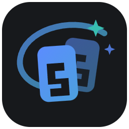
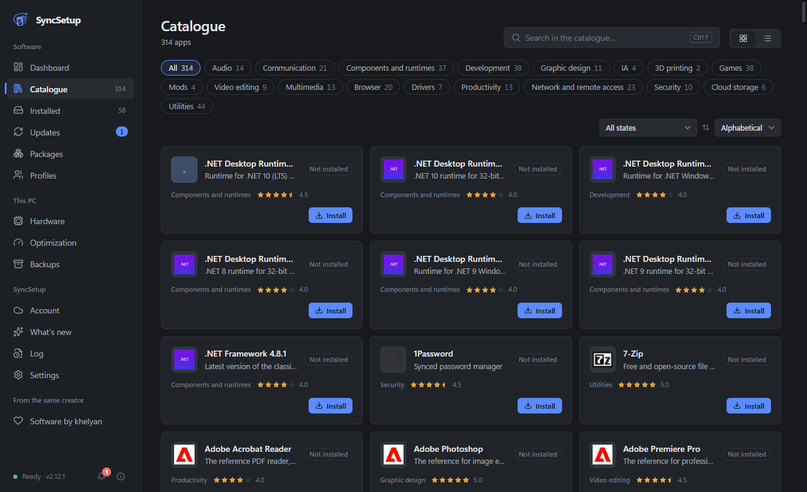
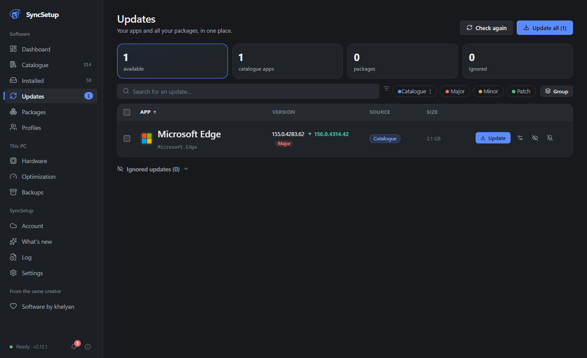
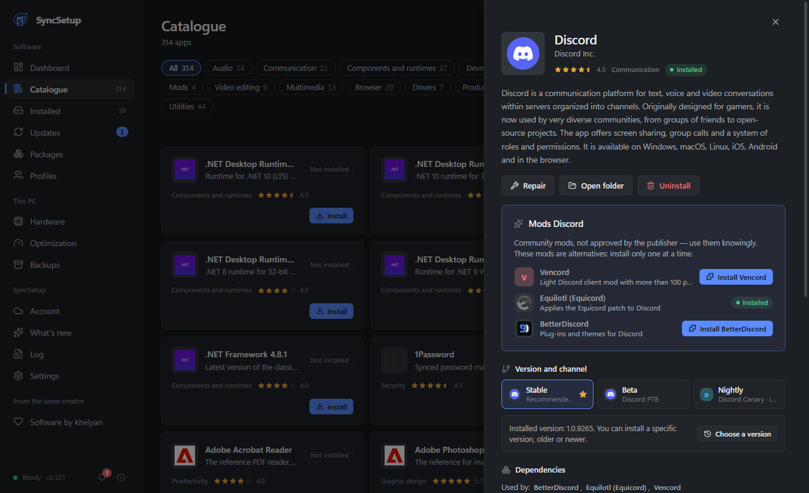
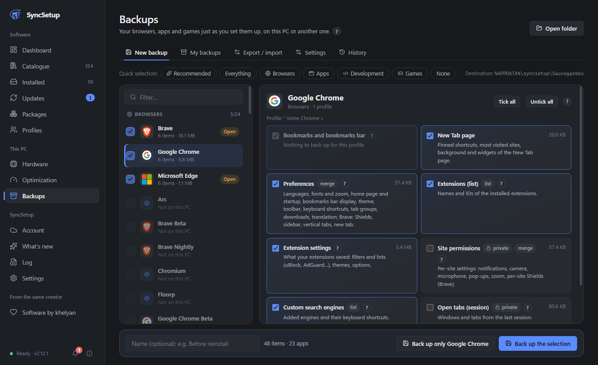
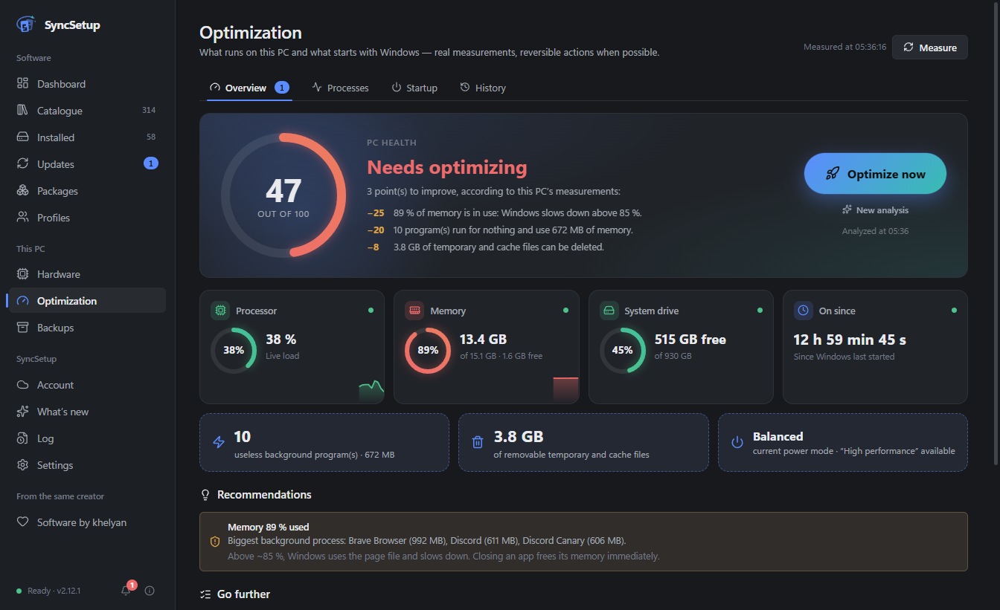
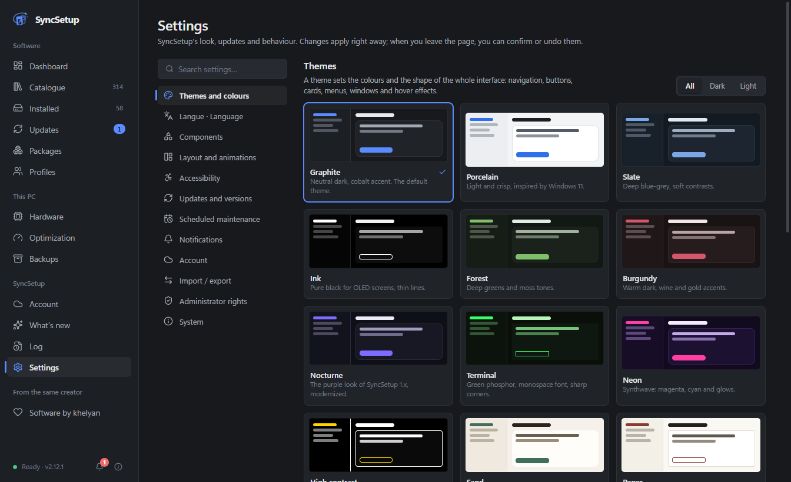

<div align="center">



# SyncSetup

### All your Windows software, in one place.

Install, update, repair and uninstall your apps — back up your browsers, apps and games — and get your whole setup back on a new PC in a few clicks.

[](https://github.com/khelyan2k/SyncSetup-releases/releases/latest) [](https://github.com/khelyan2k/SyncSetup-releases/releases)  

**[⬇️ Download](https://github.com/khelyan2k/SyncSetup-releases/releases/latest)** · **[What's new](https://github.com/khelyan2k/SyncSetup-releases/releases)** · **[Report a bug](https://github.com/khelyan2k/SyncSetup-releases/issues)** · **[🇫🇷 Version française](FR%20-%20README.md)**

<br />


</div>

<br />

## Why SyncSetup?

Setting up a PC means visiting dozens of websites, clicking through installers, then keeping everything up to date by hand. **SyncSetup does it for you** — and does it carefully:

- 🧩 **One app for everything** — 478 hand-picked apps, plus every package from winget, Scoop, Chocolatey, pip, npm and 6 other managers.
- 🔒 **Only official sources** — apps come from their publisher through winget (Microsoft's package manager) or the Microsoft Store. Never a repackaged installer.
- ✅ **Nothing is assumed** — every install, update or uninstall is checked afterwards. If it didn't work, SyncSetup tells you why, in plain words.
- 💾 **Your setup, anywhere** — profiles, backups and a full export let you move to a new PC without starting from scratch.

<br />

## ✨ Features

<table>
<tr>
<td width="50%" valign="top">

### 📦 Catalogue

**478 apps** sorted by category — browsers, games, communication, development, video, security, drivers, streaming, VPNs…

- Install in one click from the **official source**, or the **Microsoft Store** version when you prefer
- Choose a **specific version**, or a channel (stable, beta, nightly, LTS…)
- **Mods** in one click: Spicetify for Spotify, Vencord, Equicord, BetterDiscord
- Web services without a Windows app (YouTube…) as clearly labelled web shortcuts
- **Alternatives** filter: free or open-source equivalents to paid apps, with the price found and its source
- **Launch** button on installed apps

</td>
<td width="50%" valign="top">



</td>
</tr>
<tr>
<td width="50%" valign="top">



</td>
<td width="50%" valign="top">

### 🔄 Updates

All your apps **and** packages in a single list.

- Update everything in one click — **several at once** when it's safe (never two Windows Installer setups together)
- Live download speed, clear statuses: ✅ done · ℹ️ already up to date · ⚠️ needs attention · ❌ failed, with the reason
- Reminders when updates are waiting (at startup, every 2, 4 or 8 h)
- **Scheduled maintenance**: check and update automatically on your schedule, for all apps, all but some, or only some; major version changes wait for your OK
- Ignore a version, an app for good, or **postpone for 7 days**; **roll back to the previous version** while the publisher still provides it
- App whose installer changed type (Edge…): the publisher's own updater, otherwise a migration is offered, never without your OK

</td>
</tr>
<tr>
<td width="50%" valign="top">

### 🖥️ Installed apps

- Everything installed on the PC — even **portable apps** dropped on the Desktop and games installed by **Steam, Epic, Riot**…
- **Other programs** tab: uninstall anything Windows knows about, with its official uninstaller
- Changes made outside SyncSetup are picked up automatically
- Something blocks an update? SyncSetup finds which program is holding the files and offers **Close and retry**
- Uninstall **several apps at once**, with a summary before you confirm; every uninstall is verified, with no false “failed” when Windows is slow to catch up
- **History** of every operation: version before / after, duration, code, plain-language explanation and what to do

</td>
<td width="50%" valign="top">



</td>
</tr>
<tr>
<td width="50%" valign="top">



</td>
<td width="50%" valign="top">

### 💾 Backups & transfer

**76 browsers, apps and games**: bookmarks, settings, extensions, Discord and its mods, Spotify, VS Code, Minecraft worlds, Steam collections, VALORANT settings…

- Restore on this PC or another one, **integrity-checked** (SHA-256)
- **Never** any password, cookie or sign-in session
- **Export / import** all of SyncSetup in a single file
- **Profiles**: your app list, reinstalled in one click on a new PC
- Optional backup to a **secret GitHub Gist**
- **Move to a new PC**: preview of what will be installed, resumes after an interruption, final report
- Import a **`winget export`** list or a **UniGetUI** bundle

</td>
</tr>
<tr>
<td width="50%" valign="top">

### ⚡ Optimization

- **Optimize now**: closes what runs for nothing, frees memory, cleans temporary files — with a health score based on real measurements
- Knows hundreds of programs: what can be closed, what must stay open (drivers, antivirus, anti-cheat, sync…)
- **Startup manager**, including system-wide entries, with a warning before you disable something important
- Hardware and drivers at a glance, devices shown by their real name
- **Battery of Bluetooth devices** that report it to Windows, with a low-battery alert

</td>
<td width="50%" valign="top">



</td>
</tr>
<tr>
<td width="50%" valign="top">



</td>
<td width="50%" valign="top">

### 🎨 Made to feel at home

- **16 themes** (dark, light, OLED, high contrast…), accent colours, density, animations — or create your own
- **Performance profile**: lighter on modest PCs, richer on recent ones
- **English or French**
- Keyboard shortcuts, search everywhere, notification centre, system tray
- **Updates itself** (verified download, one-click rollback to any previous version)
- Guided **tutorial** on first launch (optional)
- **What's new** window after each update, shown once
- 100% local **assistant**: describe what you need, it suggests catalogue apps suited to your PC
- **Command line** for advanced users (`syncsetup.cmd`)

</td>
</tr>
</table>

<br />

## 🔒 Safe by design

| | |
|---|---|
| **Official sources only** | Apps are installed through winget or the Microsoft Store, from the publisher's own files. When SyncSetup has to download a publisher's installer itself, its **digital signature** is checked before it runs. |
| **Checked, not assumed** | An operation is reported as successful only after SyncSetup has verified the result on your PC. |
| **Your data stays yours** | Settings and backups stay on your PC (`%APPDATA%\syncsetup`). **No account required, no ads, no telemetry.** Online backup (secret GitHub Gist) only if you turn it on. The assistant and the battery readout work entirely on your PC. |
| **No secrets copied** | Backups never contain passwords, cookies, payment data or sign-in tokens. |
| **Windows security respected** | Administrator mode is optional and never bypasses Windows' UAC prompt. Important startup items and drivers are protected by a confirmation. |
| **Verified self-updates** | Each SyncSetup update is checked (SHA-512) before it's installed, and you can roll back at any time. |
| **Verifiable downloads** | Every release publishes the SHA256 hashes of its files (`SHA256SUMS.txt`): see [Verifying a download](#-verifying-a-download). |

<br />

## 📥 Installation

1. Download **`SyncSetup-Setup-x.y.z.exe`** from the **[latest release](https://github.com/khelyan2k/SyncSetup-releases/releases/latest)**.
2. Run it: pick the language, then the finish options (launch SyncSetup, start with Windows, shortcuts) — it installs for your Windows account, no administrator rights needed. Already installed? It offers to upgrade, repair or uninstall.
3. That's it. SyncSetup keeps itself up to date from now on.

> [!NOTE]
> The installer is not code-signed yet (a certificate costs several hundred euros a year), so Windows may show **“Windows protected your PC”**. Click **More info → Run anyway**. You can check any release on [VirusTotal](https://www.virustotal.com) before running it.

**Requirements:** Windows 10 or 11, 64-bit · winget (included in Windows 11 and up-to-date Windows 10).

<br />

## 🔐 Verifying a download

Every release publishes the SHA256 hash of its files: in the **`SHA256SUMS.txt`** file attached to the release and in the “Integrity check” section of its notes. If your file's hash is identical, it has not been altered.

In PowerShell, from the download folder:

```powershell
Get-FileHash .\SyncSetup-Setup-x.y.z.exe -Algorithm SHA256
```

Or in the Command Prompt:

```bat
certutil -hashfile SyncSetup-Setup-x.y.z.exe SHA256
```

SyncSetup's automatic updates do this check on their own (SHA-512 hash from `latest.yml`).

<br />

## ❓ FAQ

<details>
<summary><b>Is SyncSetup free?</b></summary>
<br />
Yes, completely — no ads, no premium version, no account needed.
</details>

<details>
<summary><b>How is it different from winget, UniGetUI or Ninite?</b></summary>
<br />
SyncSetup uses winget under the hood, like UniGetUI, and covers the whole Ninite list. On top of that it checks every result, explains errors in plain words, backs up and restores your apps' settings, moves your setup to a new PC, and helps you keep the PC clean and fast.
</details>

<details>
<summary><b>Do I need to run it as administrator?</b></summary>
<br />
No. It works with normal rights; Windows asks for permission when an installer needs it. An optional administrator mode (one Windows confirmation, once) avoids repeated prompts. Apps that refuse administrator rights are automatically run with your normal rights.
</details>

<details>
<summary><b>Where are my data and backups stored?</b></summary>
<br />
In <code>%APPDATA%\syncsetup</code> on your PC (backups in <code>%APPDATA%\syncsetup\Sauvegardes</code>, or any folder you choose — a OneDrive folder works great to find them on another PC).
</details>

<details>
<summary><b>What does SyncSetup connect to?</b></summary>
<br />
winget and the package registries you use (to install and update), GitHub (SyncSetup's own updates), icon services (app icons) — and, only if you turn it on, your GitHub Gist for online backup. If you connected GitHub, that same connection is also used to check whether you starred the repository (no extra permission). The recommendation assistant and the battery readout connect to nothing. Nothing else.
</details>

<details>
<summary><b>How do I uninstall it?</b></summary>
<br />
Windows Settings › Apps › SyncSetup › Uninstall (or run the installer again). You choose: <b>keep your data</b> (default, for a reinstall) or <b>remove everything</b> (<code>%APPDATA%\syncsetup</code> and SyncSetup's settings; your app backups can be kept). Your installed apps are never touched.
</details>

<details>
<summary><b>Does everything work for every app?</b></summary>
<br />
Install, update and uninstall: yes, for the whole catalogue. Other features depend on the app: <b>version choice</b> and <b>rollback</b> (if winget still provides the version), <b>repair</b> (if its installer offers it), <b>silent install</b> (if its installer allows it), <b>Launch</b> button (if SyncSetup finds a safe entry point), <b>mods</b> (Spotify and Discord), <b>battery</b> (only Bluetooth devices that report it to Windows). Each app's technical sheet shows what is possible.
</details>

<br />

## 💬 Support

Found a bug or have an idea? **[Open an issue](https://github.com/khelyan2k/SyncSetup-releases/issues)** — or reach me on Discord: **`.khelyan`**.

If SyncSetup saves you time, a ⭐ on this page helps a lot! And if you'd like to go further: **[☕ Support SyncSetup on Ko-fi](https://ko-fi.com/syncsetup)**.

Found a security issue? Don't post it publicly: follow [SECURITY.md](SECURITY.md) (private report).

[Terms of use](CONDITIONS_UTILISATION.md#english) · [Third-party notices](THIRD-PARTY-NOTICES.txt) · [Documentation (wiki)](https://github.com/khelyan2k/SyncSetup-releases/wiki)

<br />

<div align="center">

Made with ❤️ by **[khelyan](https://github.com/khelyan2k)**

</div>
